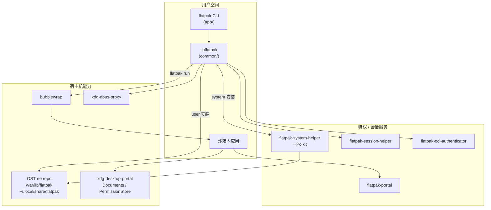
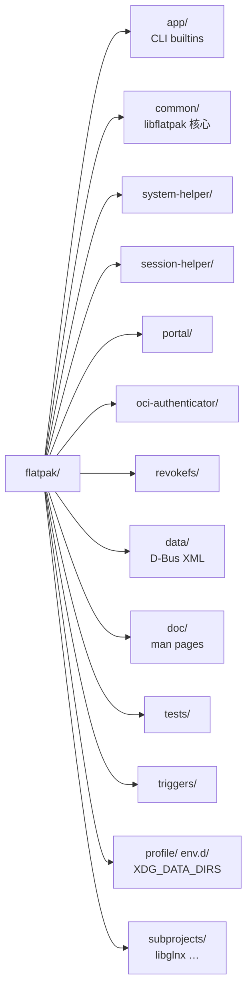
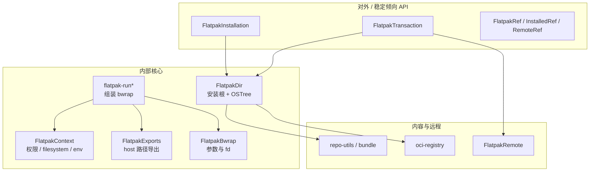
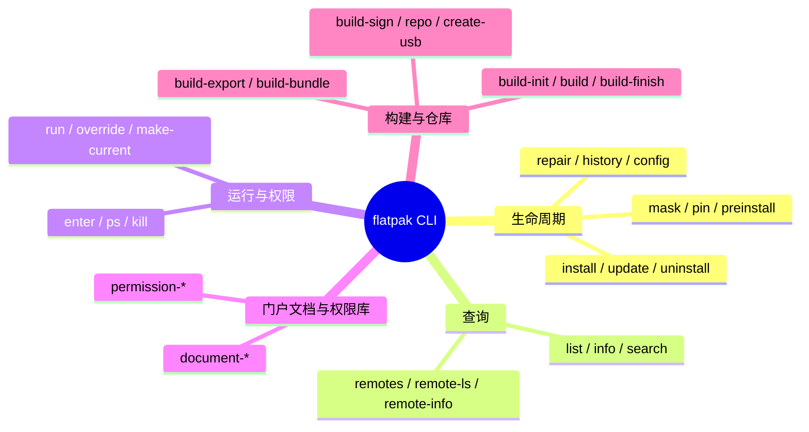
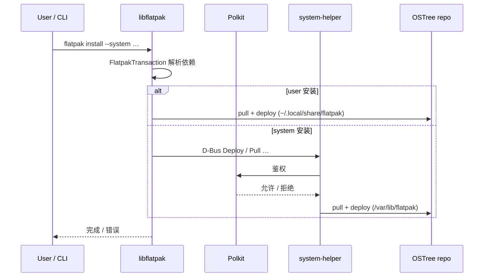
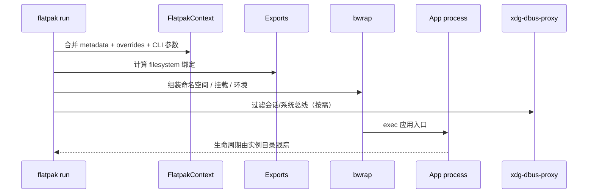
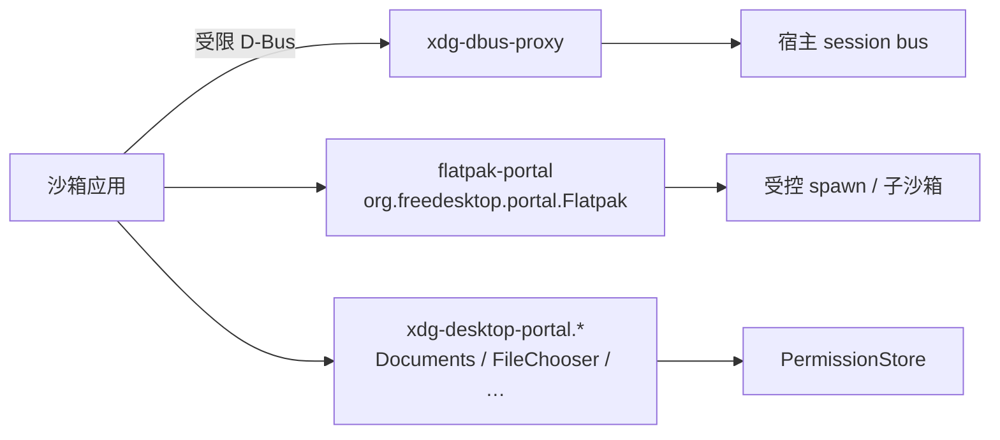
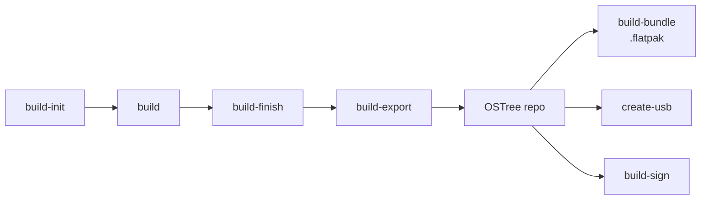
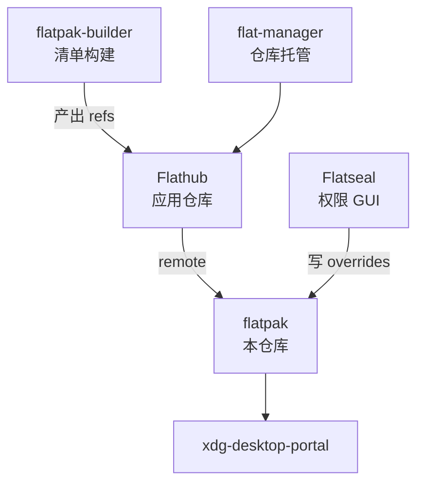

# Flatpak 技术框架结构分析

> 个人学习笔记分支，基于本仓库 `main` 源码梳理。  
> **不面向 upstream PR**；仅作远程仓库记录。

本文说明 Flatpak **本仓库**如何组织代码、进程如何协作，以及应用从「安装」到「沙箱运行」的主路径。对外产品文档仍以 [docs.flatpak.org](https://docs.flatpak.org/) 为准。

---

## 1. 一句话定位

Flatpak = **以 OSTree 为内容存储与分发** + **以 bubblewrap 做进程/文件系统沙箱** + **以 D-Bus Portal / Permission Store 做受控越权访问** 的桌面应用交付栈。

本仓库提供：

| 产物 | 作用 |
|------|------|
| `flatpak` CLI (`app/`) | 用户与发行版脚本入口 |
| `libflatpak` (`common/`) | 安装、事务、运行时上下文、导出给 gnome-software 等 |
| `flatpak-system-helper` | 系统级安装的特权操作（Polkit） |
| `flatpak-session-helper` | 每用户会话侧辅助 |
| `flatpak-portal` | `org.freedesktop.portal.Flatpak` 实现（子沙箱等） |
| `flatpak-oci-authenticator` | OCI 远程认证 |
| `revokefs` | 可撤销 FUSE 文档挂载相关 |

外部依赖（系统或 wrap）：**OSTree**、**bubblewrap (`bwrap`)**、**xdg-dbus-proxy**、**xdg-desktop-portal**（文档/权限等由门户生态提供）。

---

## 2. 总览架构图



---

## 3. 源码目录地图



| 目录 | 功能说明 |
|------|----------|
| `app/` | `flatpak` 可执行文件：每个子命令一个 `flatpak-builtins-*.c`，由 `flatpak-main.c` 分发 |
| `common/` | 共享库：目录/远程/事务/上下文/bwrap 参数/运行时挂载 |
| `system-helper/` | 系统安装 D-Bus 服务 + Polkit policy |
| `session-helper/` | 用户会话 D-Bus 服务 |
| `portal/` | Flatpak 专用 portal（如 spawn / 子沙箱） |
| `oci-authenticator/` | OCI registry 认证 helper |
| `revokefs/` | 文档门户相关的可撤销文件系统 |
| `data/` | 对外 D-Bus 接口 XML |
| `doc/` | DocBook man pages |
| `tests/` | 集成测试 / wrap |
| `triggers/` | 安装后触发器（桌面文件、图标等） |
| `profile/` / `env.d/` | 让宿主桌面看到 exports（`XDG_DATA_DIRS`） |
| `completion/` | bash/zsh 补全 |
| `meson.build` | 构建与可选组件（system-helper、selinux、sideload 等） |

---

## 4. 核心库分层（`common/`）



### 4.1 关键模块

| 模块（文件前缀） | 职责 |
|------------------|------|
| `flatpak-dir` | 一个「安装」：user/system/custom；管理 remotes、部署、override、summary |
| `flatpak-installation` | 库 API 封装 `FlatpakDir` |
| `flatpak-transaction` | install/update/uninstall 的依赖解析与执行（pull + deploy） |
| `flatpak-context` | 沙箱权限模型：`shared` / `sockets` / `devices` / `filesystems` / `persist` / env |
| `flatpak-exports` | 按 permissions 决定宿主路径如何 bind 进沙箱 |
| `flatpak-run*` | `flatpak run`：环境、X11/Wayland/Pulse/D-Bus/Cups、实例目录 |
| `flatpak-bwrap` | 构造 bubblewrap 命令行与 memfd/fd 传递 |
| `flatpak-ref-utils` | `app\|runtime/id/arch/branch` 分解与模糊匹配 |
| `flatpak-repo-utils` | summary、bundle（`.flatpak`）、签名相关 |
| `flatpak-oci-*` | OCI 镜像远程 |
| `flatpak-instance` | 运行中实例（`ps` / `kill` / `enter`） |

---

## 5. CLI 功能分组（`app/`）



入口：`app/flatpak-main.c` 将子命令映射到 `flatpak_builtin_*`。事务型命令走 `FlatpakTransaction`（CLI 包装在 `flatpak-cli-transaction.c`）。

---

## 6. 安装路径：事务与特权边界



要点：

- **User vs System**：两套（或更多 `installations.d`）独立 OSTree + 部署树。
- **system-helper**：避免日常 CLI 长期以 root 运行；写系统树经 Polkit。
- **Remote**：OSTree / OCI；Flathub 等为配置项，不在本仓库内置内容。

磁盘布局（简化）：

```text
$prefix/var/lib/flatpak/          # 默认 system
  repo/                           # OSTree
  app/<id>/<arch>/<branch>/
  runtime/...
  overrides/
  exports/                        # 导出到宿主的 desktop/icon 等

~/.local/share/flatpak/           # 默认 user（同上结构）
~/.var/app/<id>/                  # 应用可写数据 (XDG_* 映射)
```

---

## 7. 运行路径：沙箱启动



权限合并顺序（部署时 load overrides，简化）：

1. Runtime / App metadata 中的 `[Context]`
2. System-wide `global` → system per-app
3. Per-user `global` → user per-app
4. 命令行 `--filesystem` / `--socket` 等

`filesystem=host` 等语义见 `flatpak-metadata(5)`；实现上对根目录做 **denylist** 导出，并对 `/run/media` 等特殊处理。

---

## 8. Portal / 会话服务



| 组件 | 接口 / 角色 |
|------|-------------|
| `session-helper` | `org.freedesktop.Flatpak`（会话辅助） |
| `portal` | `org.freedesktop.portal.Flatpak` |
| 外部 xdg-desktop-portal | 文档、截图、设备等跨应用能力 |
| Permission Store | `flatpak permission-*` 与门户授权持久化 |

应用 **不应** 默认获得宿主全盘；按需经 portal 授权是安全模型的核心。

---

## 9. 构建与发行（仓库内工具）

开发者/打包侧常用子命令（仍由本 CLI 提供；高级清单构建多用外部 **flatpak-builder**）：



- **Runtime / SDK / App** 分层：应用依赖 runtime；SDK 用于构建。
- **Extensions**（Locale、GL、Codecs）由 metadata 声明，事务自动拉取。

---

## 10. 测试与构建系统

| 方面 | 说明 |
|------|------|
| 构建 | Meson；可选 system-helper、selinux、sideload systemd、installed-tests |
| 测试 | `tests/*.sh` + `.wrap`；本地可用 `_build/app/flatpak` |
| 隔离 | 测试常用 `FLATPAK_USER_DIR` 等指向临时目录 |
| CI | `.github/workflows/`（gcc/asan、clang、shellcheck、potfiles 等） |

---

## 11. 与生态项目的边界



---

## 12. 阅读源码的推荐路径

1. **CLI 分发**：`app/flatpak-main.c`
2. **安装事务**：`common/flatpak-transaction.c` → `flatpak-dir.c`
3. **权限模型**：`common/flatpak-context.c` + `doc/flatpak-metadata.xml`
4. **启动沙箱**：`common/flatpak-run.c` + `flatpak-bwrap.c` + `flatpak-exports.c`
5. **系统特权**：`system-helper/flatpak-system-helper.c` + `*.policy.in`
6. **Portal**：`portal/flatpak-portal.c` + `data/org.freedesktop.portal.Flatpak.xml`

---

## 13. 修订记录

| 日期 | 说明 |
|------|------|
| 2026-10-16 | 初稿：基于当时 `main` 目录与组件关系整理 |

分支：`notes/technical-architecture`（仅推送到个人 fork，不提交 upstream PR）。
